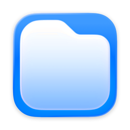

# Atlas Saver

Chrome extension that saves images, videos and screenshots from any web page into the Atlas app on macOS, with the page they came from as the source link.

## Features

- **Save media** – hold ⌥ over the top-right corner of an image or video and press **+**. X, Instagram and LinkedIn posts keep their post link.
- **Note and tags** – hold ⌘⌥ and press **+** to add a note and tags before saving. Both are written to the item in Atlas.
- **Screenshots** – ⌥⇧S (or the popup): drag an area, click for the visible screen, hold ⌥ to pick a block on the page, or press **F** for the full page. ⌥⇧F takes a full-page shot straight away.
- **Quality** – screenshots are always Retina 2×. On a non-Retina screen Chrome re-renders the area through its debugger, which briefly shows a bar at the top.
- **WebM videos** are converted to MP4 in the browser, because macOS (and so Atlas) can't read them.

## Setup

1. Open `chrome://extensions`, turn on **Developer mode**, click **Load unpacked** and pick this folder.
2. Open the extension popup, enter the **Endpoint** and **Access key** from Atlas ▸ Settings ▸ Developers, press **Save**, then **Test connection**.

Atlas must be running; the extension talks to its local MCP endpoint. Nothing is shipped with the extension: your endpoint and key only live in your browser's extension storage.

Optional: to prefill them while developing, copy `config.example.js` to `config.js` (git-ignored).

### Optional helper

Screenshots are handed to Atlas through a hidden download that is removed right after the import. If you'd rather skip Chrome's download system entirely, install the native helper once:

```bash
./helper/install.sh <extension-id>
```

The extension id is shown on `chrome://extensions`.
